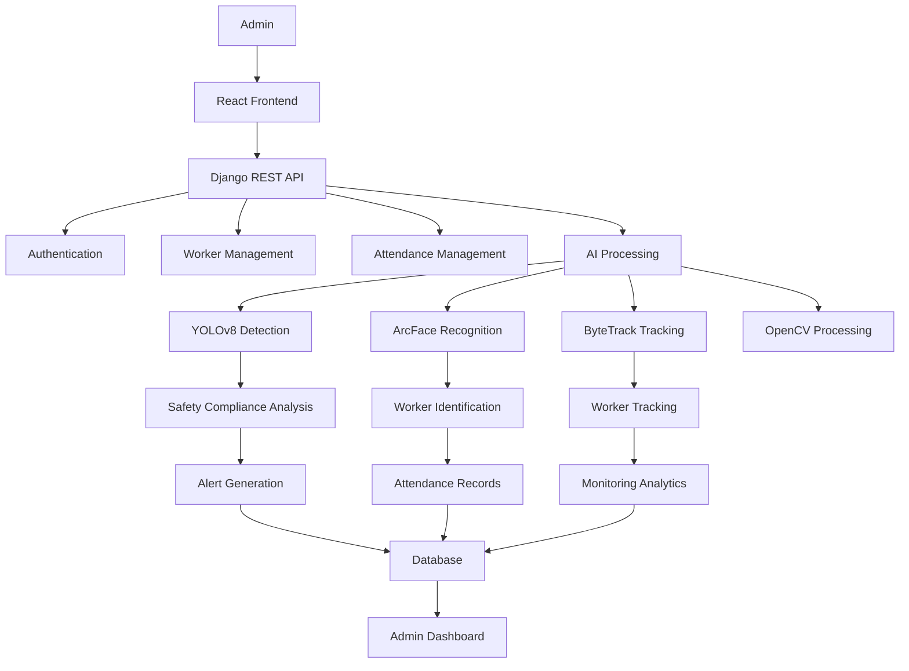

# 🦺 SafeVision
### Smart Construction Safety Compliance and Worker Monitoring System

<p align="center">
  <b>AI-Powered Construction Site Safety Monitoring Using Computer Vision and Deep Learning</b>
</p>

<p align="center">
  
  
  
  
  
  
</p>

---

## 📌 Overview

**SafeVision** is an AI-powered construction site safety compliance and worker monitoring system designed to improve workplace safety through automated computer vision and deep learning technologies.

Traditional construction site monitoring often depends on manual supervision, which can make it difficult to continuously monitor workers and identify safety violations.

SafeVision addresses this challenge by analyzing images, pre-recorded videos, and webcam streams to identify workers, monitor personal protective equipment (PPE), track worker activities, and generate alerts when safety requirements are not satisfied.

The system combines object detection, face recognition, worker tracking, and attendance management within a centralized administrator dashboard.

The primary objective is to reduce manual monitoring effort, improve safety awareness, and provide administrators with a centralized view of construction site safety compliance.

---

## 🎯 Project Objectives

- Automate construction worker safety monitoring using AI.
- Detect workers and identify missing personal protective equipment.
- Monitor essential safety equipment such as helmets, safety vests, gloves, and boots.
- Identify workers through face recognition.
- Automate employee entry and exit attendance tracking.
- Track workers across video frames.
- Generate alerts for detected safety violations.
- Provide a centralized dashboard for administrators.
- Present monitoring statistics and safety analytics.

---

## ✨ Key Features

### 1. AI-Based Worker Detection
- Detect workers from uploaded images and videos.
- Analyze webcam input for real-time monitoring.
- Identify worker locations using bounding boxes.
- Process visual information using computer vision models.

### 2. Personal Protective Equipment (PPE) Detection

SafeVision focuses on identifying essential construction safety equipment.

| Safety Equipment | Purpose |
|---|---|
| Helmet | Protects workers from head injuries |
| Safety Vest | Improves worker visibility |
| Gloves | Protects hands during construction activities |
| Safety Boots | Protects feet from workplace hazards |

The detection module identifies PPE-related objects and helps determine whether workers comply with configured safety requirements.

### 3. Face Recognition-Based Attendance

The attendance module uses face recognition technology to support automated worker identification.

Features:
- Worker face registration.
- Face-based worker identification.
- Entry attendance recording.
- Exit attendance recording.
- Attendance history.
- Shift monitoring.

**Technology:** ArcFace and OpenCV.

### 4. Worker Tracking

- Track detected workers across video frames.
- Maintain tracking IDs.
- Monitor worker movement.
- Reduce duplicate worker counting during continuous tracking.

**Technology:** ByteTrack.

### 5. Real-Time Safety Alerts

SafeVision is designed to identify safety violations and notify administrators.

Example situations:
- Worker detected without a helmet.
- Worker detected without a safety vest.
- Missing required protective equipment.
- Other configured PPE compliance violations.

### 6. Administrator Dashboard

The administrator dashboard provides a centralized interface for managing and monitoring the construction safety system.

Dashboard capabilities:
- Worker monitoring.
- PPE compliance overview.
- Safety violation alerts.
- Attendance information.
- Worker tracking information.
- Safety statistics and analytics.
- Image and video analysis.

### 7. Image and Video Analysis

The system supports multiple input sources:

- Uploaded images.
- Pre-recorded construction videos.
- Webcam streams.

This makes it possible to demonstrate and test the system without requiring an actual CCTV installation.

### 8. Modern User Interface

- React-based dashboard.
- Responsive interface.
- Dark and light themes.
- Interactive dashboard components.
- Data visualization.
- Animated interface elements.

---

## 🏗️ System Architecture

SafeVision follows a full-stack architecture that connects the frontend, backend, database, and AI processing modules.



### System Workflow

1. The administrator accesses the SafeVision dashboard.
2. An image, video, or webcam stream is selected.
3. The backend receives the input.
4. The computer vision module processes the visual data.
5. YOLO-based detection identifies workers and relevant safety equipment.
6. PPE compliance is evaluated.
7. Face recognition supports worker identification.
8. ByteTrack supports continuous worker tracking.
9. Attendance information and safety events are processed.
10. Results and analytics are presented through the administrator dashboard.

---

## 🛠️ Technology Stack

### Frontend

| Technology | Purpose |
|---|---|
| React.js | Frontend application |
| Vite | Development server and build tool |
| JavaScript | Application logic |
| HTML5 | Web structure |
| CSS3 | Styling and responsive design |
| Framer Motion | UI animations |
| Three.js | 3D visual elements |
| React Three Fiber | 3D integration with React |
| Chart.js | Data visualization |

### Backend

| Technology | Purpose |
|---|---|
| Python | AI and backend programming |
| Django | Backend framework |
| Django REST Framework | REST API development |
| JWT | Authentication |
| OpenCV | Image and video processing |

### Artificial Intelligence & Computer Vision

| Technology | Purpose |
|---|---|
| YOLOv8n | Worker and PPE object detection |
| ArcFace | Face recognition |
| ByteTrack | Multi-object tracking |
| OpenCV | Computer vision operations |

### Database

| Technology | Purpose |
|---|---|
| MySQL | Primary relational database |
| SQLite | Local development fallback |

---

## 📂 Project Modules

### 1. Authentication Module
- Administrator login.
- JWT-based authentication.
- Protected administrator access.

### 2. Worker Monitoring Module
- Worker detection.
- Worker identification.
- Worker tracking.
- Monitoring information.

### 3. PPE Detection Module
- Helmet detection.
- Safety vest detection.
- Gloves detection.
- Safety boots detection.
- Safety compliance evaluation.

### 4. Face Recognition Module
- Face detection.
- Face feature extraction.
- Worker identification.
- Attendance support.

### 5. Attendance Module
- Entry time recording.
- Exit time recording.
- Attendance history.
- Shift-based monitoring.

### 6. Alert Management Module
- Safety violation identification.
- Alert generation.
- Administrator notifications.
- Violation history.

### 7. Analytics Module
- Worker monitoring statistics.
- PPE compliance statistics.
- Safety violation summaries.
- Attendance analytics.

---

## 📸 Application Screenshots

Screenshots can be added here to demonstrate the actual application.

| Module | Screenshot |
|---|---|
| Admin Login | `docs/screenshots/login.png` |
| Admin Dashboard | `docs/screenshots/dashboard.png` |
| Live Monitoring | `docs/screenshots/monitoring.png` |
| PPE Detection | `docs/screenshots/ppe-detection.png` |
| Face Attendance | `docs/screenshots/attendance.png` |
| Safety Alerts | `docs/screenshots/alerts.png` |
| Analytics | `docs/screenshots/analytics.png` |

> Replace these paths with actual screenshots from your application.

---

## ⚙️ Installation and Setup

Follow these steps to run SafeVision locally.

### Prerequisites

Install the following software:

- Python 3.10 or later.
- Node.js and npm.
- MySQL Server 8.0 (if using MySQL).
- Git.
- Visual Studio Code (recommended).

### Step 1: Clone the Repository

```bash
git clone https://github.com/YPavansai/SafeVision.git
```

Navigate into the project:

```bash
cd SafeVision
```

### Step 2: Backend Setup

Navigate to the backend directory:

```bash
cd backend
```

Create a Python virtual environment:

```bash
python -m venv venv
```

Activate the virtual environment on Windows:

```powershell
.\venv\Scripts\Activate.ps1
```

Install dependencies:

```bash
pip install -r requirements.txt
```

Configure the environment variables according to your backend configuration.

Run database migrations:

```bash
python manage.py makemigrations
python manage.py migrate
```

Create an administrator account:

```bash
python manage.py createsuperuser
```

Start the Django development server:

```bash
python manage.py runserver
```

Backend server:

```text
http://127.0.0.1:8000/
```

### Step 3: Frontend Setup

Open another terminal and navigate to the frontend directory:

```bash
cd frontend
```

Install dependencies:

```bash
npm install
```

Start the development server:

```bash
npm run dev
```

Frontend application:

```text
http://localhost:5173/
```

### Step 4: Access the Application

1. Open the frontend URL in your browser.
2. Log in using your administrator credentials.
3. Navigate to the monitoring dashboard.
4. Upload an image or video, or use webcam input.
5. Review the available detection and monitoring results.

**Note:** Actual startup commands, environment variables, and configuration requirements should match the current repository implementation.

---

## 🧠 AI Technologies Explained

### YOLOv8 – Object Detection

YOLO (You Only Look Once) is a real-time object detection architecture.

In SafeVision, YOLOv8 is intended to identify workers and construction safety equipment.

It processes an image and predicts:
- Object classes.
- Bounding box coordinates.
- Confidence scores.

### ArcFace – Face Recognition

ArcFace is a face recognition approach that learns discriminative facial feature embeddings.

SafeVision uses ArcFace to support worker identification and attendance management.

### ByteTrack – Object Tracking

ByteTrack is a multi-object tracking algorithm.

It associates detected objects across video frames and assigns tracking IDs to help maintain worker tracking information.

### OpenCV – Computer Vision

OpenCV supports:
- Image processing.
- Video processing.
- Webcam access.
- Frame extraction.
- Face-related image operations.
- Computer vision preprocessing.

---

## 🔐 Security and Privacy

SafeVision is designed around administrator-controlled monitoring.

Important security considerations:

- Protect administrator accounts using authentication.
- Restrict access to worker records.
- Secure API endpoints.
- Store face-related information securely.
- Avoid exposing sensitive worker information.
- Use environment variables for confidential configuration.
- Validate uploaded images and videos.
- Apply suitable data retention policies.

Face recognition and automated safety decisions should be subject to appropriate human review.

---

## ⚠️ Current Limitations

SafeVision is an academic prototype intended for development, testing, and demonstration.

The following limitations should be considered:

- Detection accuracy depends on model quality and training data.
- Lighting, camera angle, occlusion, and video resolution can affect detection.
- Face recognition performance depends on image quality and registration.
- PPE classification requires appropriate trained model classes.
- Webcam processing performance depends on available hardware.
- Real-world CCTV integration requires additional deployment and infrastructure work.
- Automated detection should not replace professional construction safety supervision.

---

## 🚀 Future Enhancements

The following improvements can extend SafeVision:

1. Integration with real construction-site CCTV systems.
2. Improved YOLO model training using construction-specific datasets.
3. Better PPE detection accuracy.
4. Advanced worker tracking and re-identification.
5. Mobile application for safety notifications.
6. Email and SMS-based alert notifications.
7. Cloud-based monitoring and analytics.
8. Multi-construction-site management.
9. Advanced safety compliance reports.
10. Edge AI deployment for low-latency processing.

---

## 🎓 Academic Project Information

| Field | Details |
|---|---|
| Project Name | SafeVision |
| Project Title | Smart Construction Safety Compliance and Worker Monitoring System |
| Domain | Artificial Intelligence and Machine Learning |
| Subdomain | Computer Vision and Deep Learning |
| Project Type | Full-Stack AI Application |
| Frontend | React.js |
| Backend | Django REST Framework |
| Database | MySQL |
| Object Detection | YOLOv8 |
| Face Recognition | ArcFace |
| Object Tracking | ByteTrack |

---

## 👨‍💻 Developer

**Pavan Sai**

B.Tech – Artificial Intelligence and Machine Learning  
Malla Reddy University

Interested in Artificial Intelligence, Machine Learning, Computer Vision, Generative AI, and Full-Stack Development.

### Connect With Me

- 💻 GitHub: [YPavansai](https://github.com/YPavansai)
- 🔗 LinkedIn: [Pavan Sai](https://www.linkedin.com/in/pavan-sai-45593a332/)
- 🌐 Live Application: https://safe-vision-tan.vercel.app/

---

## 📜 License

This project is developed for academic and educational purposes.

A license file should be added to the repository to specify the terms governing usage, modification, and distribution.

---

## ⭐ Support

If you find this project interesting, consider giving the repository a star ⭐.

Your support and feedback are appreciated!

---

<p align="center">
  <b>SafeVision – Making Construction Sites Smarter and Safer Through AI.</b>
</p>
